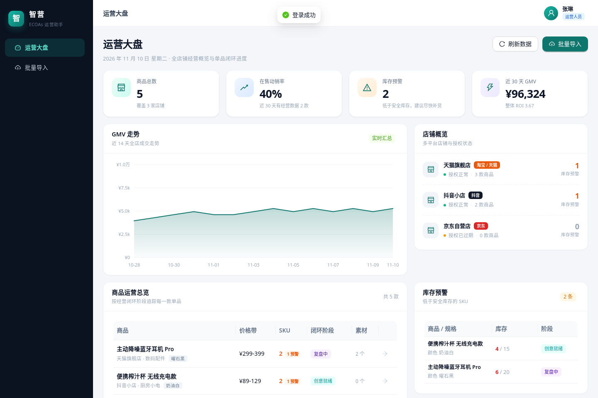
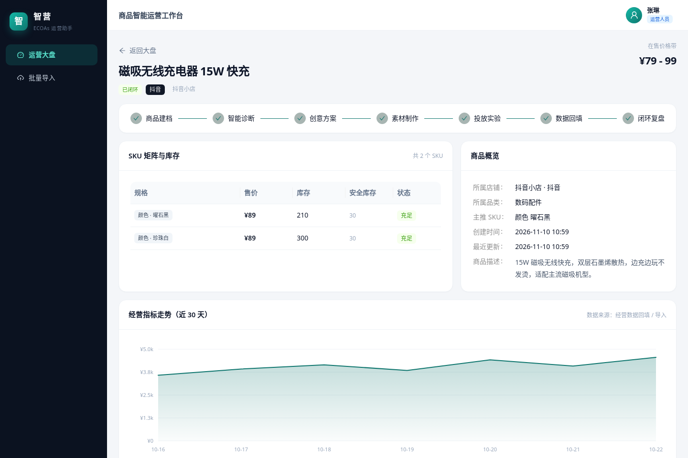
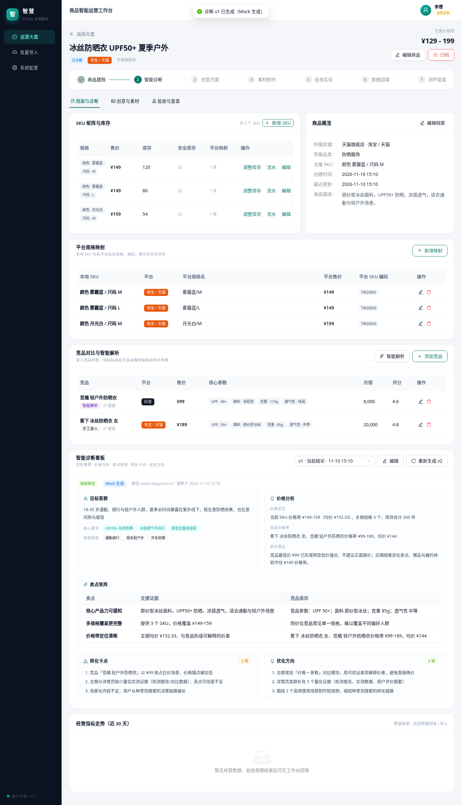
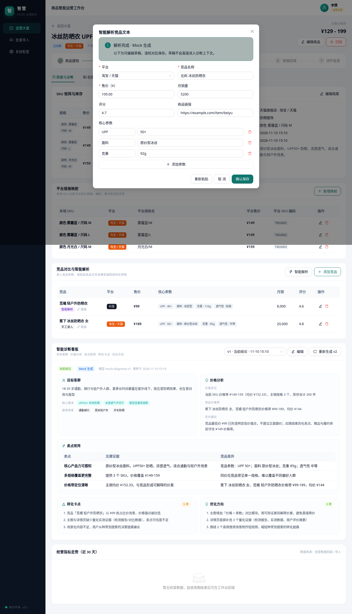
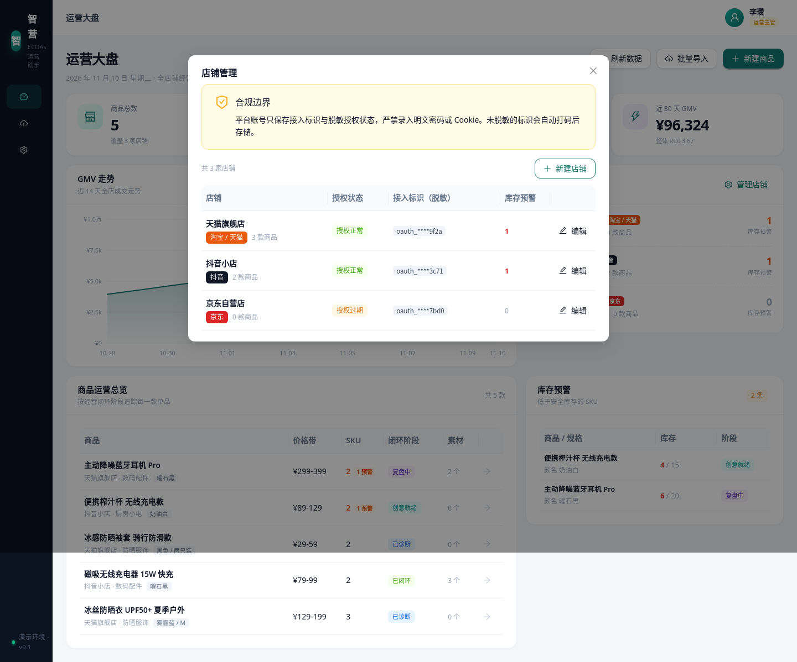

# 智营 · 电商运营助手（ECOAs）

面向电商运营团队的智能运营工作台：以单品经营全生命周期为核心，串联「商品建档与竞品诊断 → 视觉方案与分镜脚本 → 异步素材制作 → 投放实验建议 → 经营数据回填与闭环复盘」。



## 当前进度

| 里程碑 | 内容 | 状态 |
| --- | --- | --- |
| M1 | 项目骨架、登录与角色、14 张数据表、演示种子、运营大盘、商品概览 | ✅ 已完成 |
| M2 | 商品建档 / SKU 库存 / 竞品 / 智能诊断 | ✅ 已完成 |
| M3 | 创意方案、异步任务队列、素材审核归档 | ✅ 已完成 |
| M3 扩展 | 本地生活服务（除甲醛 / 洗衣店）、服务套餐与获客素材 | ✅ 已完成 |
| M4 | 投放建议审批、经营数据回填、复盘报告 | ⏳ 待开始 |
| M5 | 批量导入中心、系统配置页、演示重置 UI | ⏳ 待开始 |
| M6 | 演示引导、README 完善、全链路自测与答辩材料 | ⏳ 待开始 |

> 每个里程碑的任务拆解、验收清单与可直接复制的任务描述见 [docs/开发任务分解_M1-M6.md](docs/开发任务分解_M1-M6.md)。

## 30 秒启动

环境要求：Python 3.11+、Node.js 18+。

```bash
cd /opt/ECOAs
./start.sh
```

- 前端：http://localhost:5173
- 接口文档：http://localhost:8000/docs
- 重置演示数据：`./start.sh --reset`（或主管账号在配置页操作，M5 提供）

演示账号：

| 账号 | 密码 | 角色 |
| --- | --- | --- |
| `operator` | `123456` | 运营人员 |
| `manager` | `123456` | 运营主管 / 管理员 |

## 演示数据

5 款实物单品覆盖不同闭环阶段，用于展示阶段联动与异常提醒：

| 商品 | 店铺 | 初始阶段 | 说明 |
| --- | --- | --- | --- |
| 冰丝防晒衣 UPF50+ | 天猫旗舰店 | 建档中 | **主演示起点**，已录 3 个 SKU 与 2 个竞品 |
| 磁吸无线充电器 15W | 抖音小店 | 已闭环 | 完整历史：诊断 → 创意 → 素材 → 投放 → 数据 → 复盘报告 |
| 冰感防晒袖套 | 天猫旗舰店 | 已诊断 | 已有结构化诊断结论 |
| 便携榨汁杯 | 抖音小店 | 创意就绪 | 已有 3 组主图方案 + 3 套分镜脚本，库存告警 |
| 主动降噪蓝牙耳机 Pro | 天猫旗舰店 | 复盘中 | 高风险投放已审批、14 天经营数据回填中，库存告警 |

另有 3 家实物店铺（其中京东店授权过期）用于展示多平台授权状态。

本地生活服务演示数据（增量幂等，重复启动不会重复创建）：

| 服务商品 | 店铺 | 初始阶段 | 说明 |
| --- | --- | --- | --- |
| 净呼吸除甲醛 · 全屋空气治理 | 净呼吸除甲醛（本地生活） | 已诊断 | 全屋检测 ¥299/3 点、全屋治理 ¥45/㎡、母婴急住治理 ¥68/㎡；2 家本地竞品，可直接生成获客素材方案 |
| 洁净洗衣 · 上门取送 | 洁净洗衣（本地生活） | 创意就绪 | 洗鞋 ¥29/双、羽绒服清洗 ¥49/件、四件套清洗 ¥69/套；满 ¥99 上门取送免运费；预置 3 组获客方案 + 3 套分镜 |

## M1 已实现

- 登录页与 JWT 会话（PBKDF2 密码哈希，非明文）；角色守卫（主管专属接口返回 403）
- 运营大盘：商品总数、在售动销率、库存预警、近 30 天 GMV / ROI 四类 KPI
- 14 天全店 GMV 走势图（自绘 SVG，含十字准线与悬浮提示，无第三方图表依赖）
- 店铺概览卡片：平台、脱敏授权状态、商品数、库存预警数
- 商品运营总览表：价格带、SKU 预警、闭环阶段标签，点击进入商品详情
- 商品详情：SKU 矩阵与库存、商品概览、30 天经营走势、七阶段闭环 Steps
- 库存预警列表（单品工作台与大盘联动入口）
- 后端 14 张表结构与完整演示种子；`POST /api/demo/reset` 一键重置（主管权限）
- 后端 pytest 基础用例 6 条



## M2 已实现

- 店铺管理（主管专属）：新建 / 编辑店铺与授权状态，授权标识仅保存脱敏值，运营账号访问写接口返回 403
- 商品建档：新建商品时一次录入基础信息、首批 SKU 与平台规格映射；支持编辑、归档 / 恢复
- SKU 矩阵：多规格 SKU 增删改，售价、库存、安全库存维护；库存调整写入流水（操作人、原因、前后值），低于阈值即时预警
- 平台规格映射：SKU 与淘宝 / 京东 / 抖音 / 拼多多平台规格、售价、编码的对应关系 CRUD
- 竞品管理：竞品参数 CRUD；「智能解析」只处理用户粘贴的文本，生成可编辑草稿后再确认入库，不抓取外部页面
- 智能诊断：按目标客群、价格分析、卖点矩阵、转化卡点、优化方向五段生成结构化诊断；支持编辑当前版本、版本历史与「当前结论」标记
- 复盘联动：生成诊断可传入 `source_report_id`，自动带入复盘行动项与指标对比
- LLM 双通道：默认确定性 Mock；可切换真实 Anthropic Messages API / OpenAI 兼容接口，输出经 Pydantic 校验，失败自动回退并标注通道，日志不输出密钥
- 商品详情升级为「档案与诊断 / 创意与素材 / 投放与复盘」三 Tab 工作区，「投放与复盘」Tab 为 M4 占位
- 后端 pytest 用例 12 条；前端 `npm run build` 通过







## M3 已实现

- 创意方案生成：基于当前版本诊断生成 **≥3 组主图方案 + ≥3 套视频分镜**（每套 ≥4 镜）；真实通道输出不足时自动补足并提示，结构校验失败整体回退 Mock
- 全字段在线编辑：主图文案 / 构图 / 卖点 / 视觉提示；脚本标题、3 秒钩子、结尾促单与分镜表格（时长、画面、口播、促单话术）增删改；支持确认、归档与方案版本递增，编辑已确认内容会自动回到草稿
- 异步任务引擎：SQLite `generation_tasks` 队列 + 应用内 worker 线程池（默认并发 2），覆盖 `pending / running / succeeded / failed / timeout / cancelled`；5 秒心跳、巡检线程超时回收、失败重试（默认 2 次）、取消与重试按钮按状态启用
- 每次执行写入 `task_attempts` 时间线；任务详情展示执行线程、心跳、超时阈值、错误信息、结果素材与附件
- 模拟生成：主图输出 SVG（构图 / 文案 / 卖点），视频输出 SVG 动效预览并附可下载的 JSON / Markdown 分镜脚本；文件版本自增，经 `/files/assets/...` 静态访问
- 素材库：卡片网格类型 / 状态筛选、悬浮预览与下载、审核通过 / 驳回（驳回必填备注）、打标（≤10 个）与归档
- 创意方案与素材状态自动联动商品阶段：生成创意方案后进入「创意就绪」，素材审核通过后进入「素材就绪」
- Tab 2「创意与素材」：方案卡片、分镜表格、任务 2 秒轮询与时间线、素材卡片网格

### M3 服务行业扩展

- 新增 `local` 本地生活平台，店铺、竞品、平台映射下拉框均可选择
- 后端集中 `SERVICE_PROFILES` 维护「除甲醛服务」「洗衣服务」的价格单位、人群场景、套餐、信任点、CTA、素材模板与禁用词
- 商品列表 / 详情派生 `is_service`、`price_unit`，不新增数据库字段；实物商品逻辑保持不变
- 服务套餐 SKU 自动库存 9999、安全库存 0，不参与库存调整与流水，大盘 / 店铺库存预警自动排除
- 服务商品诊断与创意 Mock / 真实提示词注入服务口径；创意仍保证 ≥3 组获客方案、≥3 套分镜、每套 ≥4 镜
- 服务 SVG 素材按品类切换模板（洁净空气 / 检测质保、衣物洗护 / 上门取送），标签「获客素材」，固定标注「模拟生成，仅供方案评审」
- 前端：商品行「服务」标识与服务价格单位、详情页「服务套餐与价格」并隐藏库存操作、「获客素材方案」术语、品类快捷选项
- 合规口径：除甲醛禁用「零甲醛」「100% 去除」「永久有效」；洗衣禁用「100% 洗净」「绝对不伤衣」
- 后端 pytest 用例 21 条（服务扩展新增 4 条：seed 幂等、创意下限与关键词、SVG 标签、服务库存语义）；前端 `npm run build` 通过

### M3 验收清单

- [x] 生成 ≥3 组主图方案与 ≥3 套分镜脚本，全部字段可在线编辑
- [x] 创建图片与视频异步任务，查看全部任务状态
- [x] 取消 pending / running 任务，对 failed / timeout 任务重试
- [x] 失败率 / 耗时 / 超时可配置，稳定演示失败重试与超时回收
- [x] 任务成功后素材自动入库，可审核、打标、归档
- [x] 前端 2 秒轮询状态，任务时间线完整
- [x] pytest 与 `npm run build` 通过
- [x] 服务扩展：两家服务店铺与两个服务商品增量幂等出现，创意下限、服务关键词、SVG 标签与库存语义均有测试覆盖

## 技术栈

- 前端：React 18 + TypeScript + Vite + Ant Design 5
- 后端：FastAPI + SQLAlchemy 2 + SQLite
- 图表：自绘 SVG（GMV 走势），避免额外运行时依赖
- 鉴权：JWT（HS256）+ 角色权限；密码 PBKDF2-SHA256 加盐哈希
- AI 能力：真实接口 + 确定性 Mock 双通道；默认 Mock，真实模式支持 Anthropic Messages API 与 OpenAI 兼容接口，密钥仅从系统配置或环境变量读取

## 目录结构

```
ECOAs/
├── server/                 FastAPI 后端
│   ├── app/
│   │   ├── api/            路由：auth / stores / products / skus / competitors / diagnoses /
│   │   │                   creative / tasks / assets / dashboard / demo
│   │   ├── engine/          异步任务 worker 线程池、超时巡检与 SVG 模拟生成器
│   │   ├── services/       领域服务（生命周期派生、LLM 双通道、系统配置）
│   │   ├── models.py       14 张数据表
│   │   ├── seed.py         演示种子数据
│   │   └── main.py         应用入口
│   ├── tests/              pytest
│   └── data/               SQLite 与 assets/ 素材文件
├── web/                    React 前端
│   └── src/
│       ├── api/            请求封装与类型
│       ├── auth/           登录态与路由守卫
│       ├── layout/         侧栏 + 顶栏框架
│       ├── pages/          登录 / 大盘 / 商品详情 / 导入 / 配置
│       └── components/     阶段标签、SVG 走势图、商品档案 / SKU / 竞品 / 诊断组件、店铺管理
├── docs/screenshots/       界面截图
├── start.sh                一键启动
└── README.md
```

## 常用命令

```bash
# 后端测试
cd server && .venv/bin/python -m pytest -q

# 前端类型检查与构建
cd web && npm run build

# 仅启动后端
cd server && .venv/bin/uvicorn app.main:app --reload

# 仅启动前端
cd web && npm run dev
```

## 数据模型概览

`users`、`stores`、`products`、`skus`、`platform_sku_mappings`、`stock_flows`、`competitors`、`diagnoses`、`creative_plans` + `image_schemes` + `video_scripts` + `video_shots`、`assets`、`generation_tasks` + `task_attempts`、`placements` + `approval_logs`、`metric_records`、`review_reports`、`import_jobs` + `import_errors`、`system_configs`。

商品闭环阶段由数据派生：建档中 → 已诊断 → 创意就绪 → 素材就绪 → 投放中 → 复盘中 → 已闭环。

> 合规边界：平台账号仅保存接入标识与脱敏授权状态；投放建议只作为决策参考，不调用任何外部广告接口或资金扣费。
